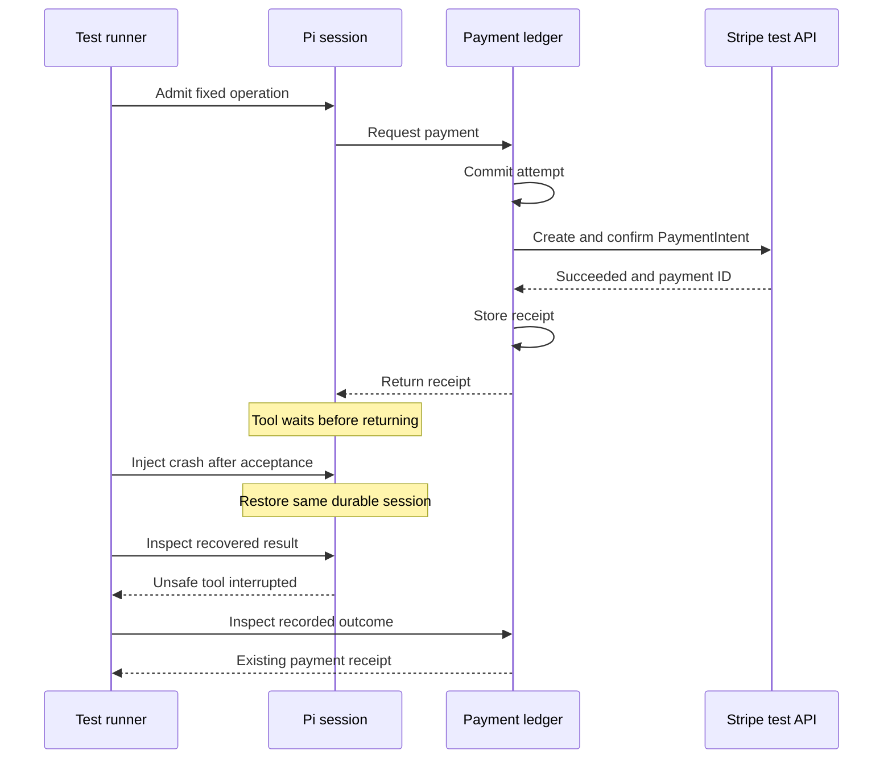

# The payment succeeded. The agent crashed. What should recovery do?

**A fault-injection case study with Cloudflare PiHarness and Stripe test mode**

By [ayobamih](https://github.com/AyobamiH) · 22 October 2026

Baseline: `agents@0.28.1`, `@earendil-works/pi-durable@1.3.0` · [Evidence commit](https://github.com/AyobamiH/pi-durable-stripe-crash-lab/commit/ef235c267da51867b042a43e0cc8323781c19991)

## The result

Two separate GBP 1.00 Stripe **test-mode** PaymentIntents succeeded: one during a local Wrangler crash/restart experiment and one in a hosted Cloudflare Durable Object experiment. In each observed recovery, the unsafe Pi tool was reported as interrupted, its recorded execution count remained one, and the application rejected a duplicate submission of the same operation. Stripe readback found the two expected payment objects. No real money moved.

The hosted test required a correction to the test runner's acceptance assertion. Its initial failed result is preserved alongside successful readback of the **same payment**. This matters to how the result should be interpreted.

This is a small, version-pinned integration case study. It supports the documented replay behaviour in the tested scenarios; it does not establish a new Pi defect, universal exactly-once execution or a first-of-its-kind discovery.

Start with the [execution record][execution], [local result][local], [hosted result][hosted] and [Stripe readback][stripe]. The companion [evidence guide](evidence-guide.md) explains which claims a public reader can check and which require account access.

## The question came from a publishing system

The original engineering question was whether Pi Durable could improve recovery in Post-Once and a wider website estate.

A publishing system can send a post successfully and then lose the response. A payment integration can create a payment successfully and then lose the agent's progress. In both cases, “the process failed” does not tell us whether the external action happened.

The experiment focused on a narrower question:

> After Stripe accepts a payment, but before the Pi tool returns its result, what happens if the agent crashes and resumes?

Stripe was useful because its API objects and events provide another place to inspect the outcome. A fixture can exercise control flow; a Stripe test object also exercises the actual provider boundary. Test mode still does not represent real-money settlement, customer authentication or bank failure behaviour.

## What was already known

Cloudflare already documents the distinction: a replay-safe tool may run again after interruption; an unsafe tool is reported as interrupted so the model can decide what to do next. The [Pi extension documentation](https://developers.cloudflare.com/agents/harnesses/pi/extensions/#mark-tools-replay-safe) describes that contract.

The value here is making one integration boundary inspectable: pinned source, explicit crash points, separate ledgers, provider object IDs, failed attempts and readback checks. A review of public documentation cannot establish what Cloudflare has tested internally, and this study makes no such claim.

On 22 October, Cloudflare [announced Agents 0.30.0 with Pi 1.4](https://developers.cloudflare.com/changelog/post/2026-10-22-pi-harness-pi-1-4/). Those versions are **not covered** by this baseline. A comparison must use fresh session storage: Cloudflare documents a Pi 1.4 storage migration that Pi 1.3 cannot reopen.

## The experiment

The lab uses the real PiHarness with a deterministic faux model. That removes paid LLM inference and makes the requested tool sequence predictable. It also limits the conclusion: the experiment does not test how a production model might react to an interrupted result or propose a new operation.

The locked dependencies include Agents 0.28.1, Pi Durable 1.3.0, Pi AI 1.3.0 and Wrangler 4.151.1. See the [lockfile][lock].

The hosted arrangement separates three responsibilities:

| Component | Responsibility | Payment authority |
| --- | --- | --- |
| Agent Worker and Pi session | Admit the fixed operation; run the unsafe tool; recover its transcript | No Stripe API key |
| Private gateway and PaymentLedger | Record an attempt; enforce account, amount and operation scope; call Stripe; retain the receipt | Test key, service-binding access only |
| Webhook receiver and WebhookLedger | Verify the signed event; retain delivery and payment records | Webhook signing secret only |

The critical interval is between provider success and completion of the tool result:



The runner inspects the gateway through the protected agent control route. Pi does not automatically reconcile Stripe payments in this experiment.

The local experiment kills its own Wrangler process group with SIGKILL and restarts against the same persistence. The hosted experiment invokes `DurableObjectState.abort()` after provider acceptance. Cloudflare [documents abort as immediately resetting the object](https://developers.cloudflare.com/durable-objects/api/state/#abort). This is a deliberate reset, not a measurement of a naturally occurring outage.

## What the evidence says

| Experiment | Recorded result | Evidence |
| --- | --- | --- |
| Local, real Stripe test API | One tool execution, one gateway request, one Stripe creation request; unsafe tool interrupted after restart | [Local JSON][local] |
| Hosted, real Stripe test API | Instance changed; terminal interrupted-tool result; matching receipts; duplicate operation rejected; counts stayed at one | [Recovery JSON][hosted] |
| Before-request crash, fixture | One interrupted tool; zero gateway and Stripe creation requests | [Before-request JSON][before] |
| Read-only replay control | Unsafe: one call and interruption. Safe: two calls and completion | [Replay JSON][replay] |
| Hosted webhook | Original delivery plus two test-generated signed replays; one payment marker and one event ID retained | [Webhook JSON][webhook] |
| Separate Stripe readback | Two succeeded GBP 1.00 test PaymentIntents; both matched the expected operation metadata | [Readback JSON][stripe] |

The payment identifiers are:

| Run | PaymentIntent | Operation |
| --- | --- | --- |
| Local | `pi_3UTReLGbPfXt7ec50W8SyVvv` | `lab-work-20261022-local` |
| Hosted | `pi_3UTRr4GbPfXt7ec50z2eLbbo` | `lab-work-20261022-hosted-v2` |

The exported provider-window list contains those two objects with `has_more: false`. This is a bounded observation made at 19:45:57 UTC on 22 October, not a claim that no future payment could ever be created.

The hosted readback runner also makes three further receipt/counter assertions after duplicate submission. Its [source][readback-runner] exposes those checks; the exported JSON retains the final state rather than all three intermediate samples.

## The failed assertion is part of the result

The first hosted attempt failed before any payment request because the runtime rejected the gateway's `redirect: "error"` setting. The diagnostic records zero Stripe creation requests. The gateway was corrected to use manual redirect handling and response validation. This was a lab implementation correction.

In the subsequent payment run, Stripe succeeded and the deliberate abort returned its expected error. A replacement object had a different instance ID. However, the runner waited for a marker written just before abort; that marker was absent, and the runner reported failure.

The original [failed result][failed] remains unchanged. A separate recovery readback of the same operation then checked the recorded abort response, changed instance, terminal transcript, receipts and counters. It did not create a replacement payment. The runner's assertion was corrected, but **the corrected full hosted runner was not then rerun with a third payment**.

That is narrower, more useful evidence than silently presenting the original run as green. An observation written at the crash boundary should not be the only oracle used to establish recovery.

## What the webhook test actually proves

The receiver recorded Stripe's original `payment_intent.succeeded` event. The runner then signed and submitted two HTTP replays of that original payload. An invalid signature was rejected.

The result was three deliveries, one event ID and one stored payment marker. The field named `businessConsequences` remains one because the [handler assigns that marker][webhook-source]. It does **not** count calls to a real fulfilment system. This test therefore supports signature handling and convergence of the lab's stored record, not exactly-once order fulfilment, email delivery or entitlement creation.

The duplicate requests came from the test runner, not Stripe's automatic retry scheduler. Stripe's [webhook guidance](https://docs.stripe.com/webhooks#handle-duplicate-events) explains why duplicate handling is necessary. Separate-event duplicates, out-of-order delivery and a crash between downstream fulfilment and acknowledgement remain untested here.

## Why stopping replay is only one layer

The gateway commits an attempt before the outbound request. An existing successful operation returns its receipt; an attempt with an uncertain outcome is not blindly retried. The [gateway implementation][gateway] makes that trade-off visible.

This favours avoiding a second effect over automatic progress. If the provider outcome is unknown, an operator or reconciliation mechanism still needs to establish what happened. The real-provider experiments crashed after a successful receipt was available; a lost provider response is covered by a mocked unit test, not an actual Stripe network-failure experiment.

A stable business operation ID ties the application request, ledger, Stripe idempotency key and metadata together. Stripe idempotency supplies an additional boundary. For API v1, Stripe documents that keys can be removed once at least 24 hours old; reusing a pruned key can create a new request. Its [idempotency documentation](https://docs.stripe.com/api/idempotent_requests) is a reason to retain business-level state rather than treating provider key retention as a permanent ledger.

An unsafe tool policy also does not stop a real model from asking for a *different* operation later. Authorisation and business identity need to remain application responsibilities.

## How to inspect or reproduce it

Public readers can inspect the immutable evidence links and run the offline checker from the published checkout:

```sh
node scripts/verify-evidence.mjs
```

That checks SHA-256 hashes and cross-file relationships. It makes no network calls and needs no credentials. It verifies the archive's integrity and internal consistency, not the historical truth of a Stripe response.

The [README][baseline-readme] contains offline reproduction commands and the owner-scoped Stripe setup. The hosted resources have been retired: the temporary webhook was deleted, hosted payment/signing secrets removed and public lab endpoints disabled. Reproduction needs a new isolated account/operation configuration and fresh deployment; archived operation IDs are not a ready-to-run public demo.

The experiment's “independent readback” means a separate Stripe access path, outside the test runner. It was performed under the same owner's account, with AI assistance. It is not an independent third-party audit or a Stripe-signed public attestation. Account holders can re-query the objects; unauthenticated readers cannot. [Verification boundaries](evidence-guide.md) make that distinction explicit.

## What this changes for an application

For Post-Once, the relevant lesson is to preserve the identity and evidence of an attempted publication before deciding whether to retry. A social provider's readback and deduplication capabilities must be tested separately; the Stripe result does not establish them.

PiHarness is relevant when the application needs a durable model-and-tool loop. A deterministic recovery workflow can continue using Durable Objects and an application ledger without introducing a new model loop.

The strongest follow-up experiments are a fresh-version comparison, a real lost-response boundary, and a webhook handler that performs a measurable downstream action with its own durable deduplication. Those would extend this baseline; they have not been completed.

**Authorship and assistance:** published by ayobamih. Implementation, execution orchestration and drafting used ChatGPT/Codex assistance. The linked records describe actual test executions, with limitations and failed attempts retained. No Cloudflare or Stripe endorsement is implied.

[execution]: https://github.com/AyobamiH/pi-durable-stripe-crash-lab/blob/ef235c267da51867b042a43e0cc8323781c19991/docs/execution-20261022.md
[local]: https://github.com/AyobamiH/pi-durable-stripe-crash-lab/blob/ef235c267da51867b042a43e0cc8323781c19991/docs/evidence-20261022/local-stripe.json
[hosted]: https://github.com/AyobamiH/pi-durable-stripe-crash-lab/blob/ef235c267da51867b042a43e0cc8323781c19991/docs/evidence-20261022/hosted-recovery-readback.json
[stripe]: https://github.com/AyobamiH/pi-durable-stripe-crash-lab/blob/ef235c267da51867b042a43e0cc8323781c19991/docs/stripe-independent-readback-20261022.json
[before]: https://github.com/AyobamiH/pi-durable-stripe-crash-lab/blob/ef235c267da51867b042a43e0cc8323781c19991/docs/evidence-20261022/before-request.json
[replay]: https://github.com/AyobamiH/pi-durable-stripe-crash-lab/blob/ef235c267da51867b042a43e0cc8323781c19991/docs/evidence-20261022/replay-comparison.json
[webhook]: https://github.com/AyobamiH/pi-durable-stripe-crash-lab/blob/ef235c267da51867b042a43e0cc8323781c19991/docs/evidence-20261022/webhook.json
[failed]: https://github.com/AyobamiH/pi-durable-stripe-crash-lab/blob/ef235c267da51867b042a43e0cc8323781c19991/docs/evidence-20261022/hosted-initial-assertion-failed.json
[lock]: https://github.com/AyobamiH/pi-durable-stripe-crash-lab/blob/ef235c267da51867b042a43e0cc8323781c19991/package-lock.json
[readback-runner]: https://github.com/AyobamiH/pi-durable-stripe-crash-lab/blob/ef235c267da51867b042a43e0cc8323781c19991/scripts/hosted-recovery-readback.mjs
[webhook-source]: https://github.com/AyobamiH/pi-durable-stripe-crash-lab/blob/ef235c267da51867b042a43e0cc8323781c19991/src/hosted-webhook.ts
[gateway]: https://github.com/AyobamiH/pi-durable-stripe-crash-lab/blob/ef235c267da51867b042a43e0cc8323781c19991/src/hosted-gateway.ts
[baseline-readme]: https://github.com/AyobamiH/pi-durable-stripe-crash-lab/blob/ef235c267da51867b042a43e0cc8323781c19991/README.md
